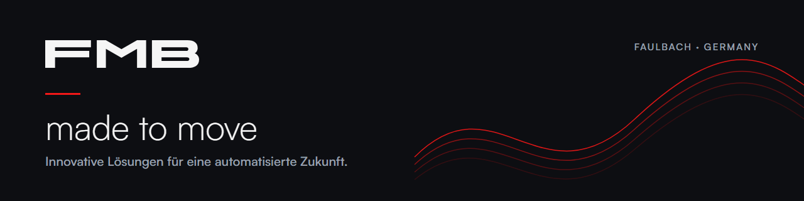

  

**FMB Maschinenbaugesellschaft mbH & Co. KG** aus Faulbach entwickelt Automatisierung für die Zerspanung:
Stangenlademagazine, Roboterzellen und Handlingsysteme.

Hier liegt die interne Softwareentwicklung von FMB: Werkzeuge, die unsere Prozesse digital, schnell
und verlässlich machen. Die Repositories sind nicht öffentlich.

🌐 [www.fmb-machinery.com](https://www.fmb-machinery.com)
